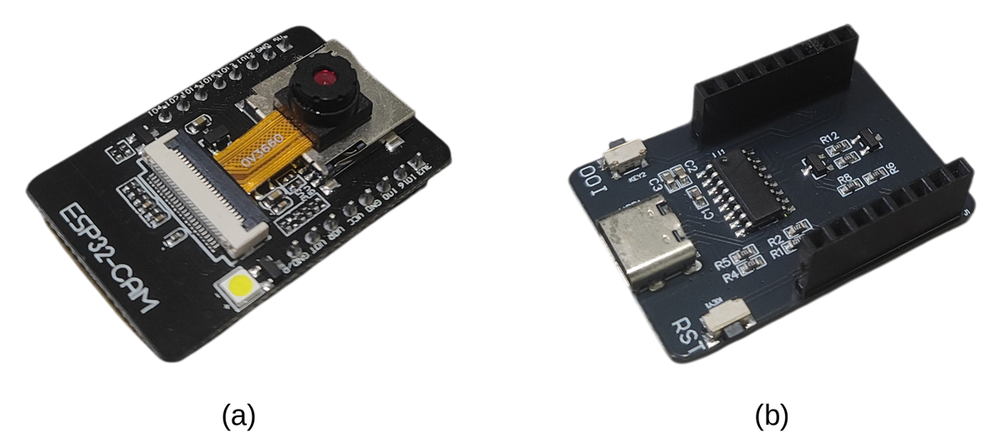
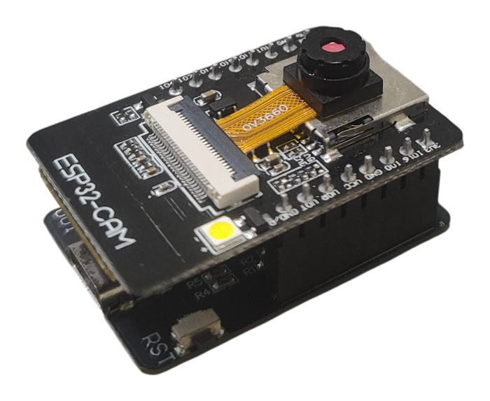
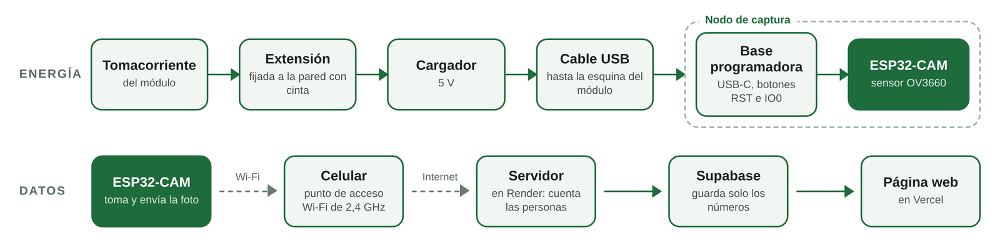
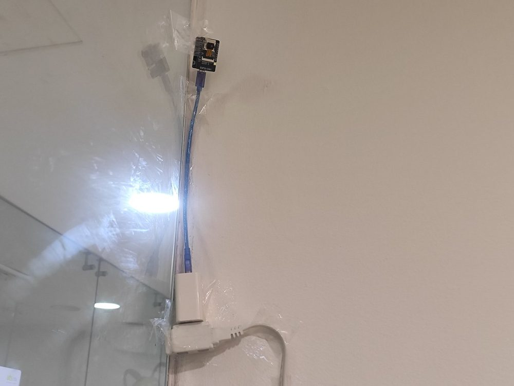

# Ocupación de los módulos de tutoría · UTS

Sistema que muestra en tiempo real cuántas sillas están libres en los módulos de tutoría del sótano de la Universitaria Tecnológica de Santander. Así los estudiantes no tienen que bajar a mirar. En cada módulo hay una cámara ESP32-CAM que toma una foto por minuto. Un servidor cuenta a las personas con visión artificial (YOLO11n) y guarda **solo el número**. La página web se actualiza sola.

Es el trabajo de grado *«Sistema inteligente de monitoreo en tiempo real para la gestión de ocupación en módulos de tutoría»*, de Neiver Yesid Granados y Juan Carlos García González.

**Página pública:** https://ocupacion-modulos-uts.vercel.app

---

## Cómo funciona

```
 ESP32-CAM  ──HTTPS + clave──►  Servidor en Render  ──solo números──►  Supabase  ──tiempo real──►  Página web
 (1 foto/min)                    FastAPI + YOLO11n                    PostgreSQL                  Vercel
                                 (la foto se borra)
```

1. **La cámara** toma una foto durante el horario de la sede (lunes a viernes de 6:00 a. m. a 8:00 p. m. y sábados de 7:00 a. m. a 12:00 m.) y la envía por HTTPS con la clave del dispositivo. Fuera del horario, los domingos y los festivos de Colombia se queda en suspensión profunda.
2. **El servidor** revisa la clave y el módulo y cuenta a las personas con YOLO11n. Con ese número calcula las sillas ocupadas y libres. La foto se analiza en memoria y no se guarda en ningún lado.
3. **Supabase** guarda cada lectura: el módulo, la hora, las personas y las sillas. También guarda los usuarios del panel, el horario de tutorías y las materias.
4. **La página web** está suscrita a la base de datos y muestra el cambio apenas llega una lectura nueva, sin recargar.

## El nodo de captura

Cada módulo con cámara tiene un nodo formado por dos placas que encajan una sobre otra:

- **ESP32-CAM (AI Thinker)** con el sensor OV3660: toma la foto y la envía por Wi-Fi.
- **Base programadora** con puerto USB-C y botones RST e IO0: sirve para cargar el programa desde el computador y para alimentar la placa, que no trae USB propio.

<p align="center">
  <br>
  
</p>

Para dejarlo funcionando en el módulo se necesita además:

| Elemento | Para qué sirve |
|---|---|
| Cable USB | Lleva la energía del cargador a la base |
| Cargador de 5 V | Alimenta la placa desde el tomacorriente |
| Extensión eléctrica | Acerca la energía hasta la esquina donde va la cámara |
| Cinta adhesiva | Sujeta la placa en la esquina y fija el cable a la pared |
| Celular con punto de acceso | Da internet en 2,4 GHz, porque el Wi-Fi de la universidad no llega al sótano |

Así se conectan la energía y los datos:

<p align="center"></p>

La placa va arriba en una esquina del módulo, cerca del techo, apuntando en diagonal hacia la mesa para ver las cuatro sillas en una sola toma.

<p align="center"></p>

> Durante las pruebas el nodo se instaló por sesiones y se retiraba al terminar: el Wi-Fi de la universidad no llega a los módulos y la conexión depende del celular de un integrante.

## Qué hay en cada carpeta

```
proyecto-tutoria/
├── backend/                     Servidor de análisis (Python)
│   ├── main.py                  API con FastAPI: recibe la foto, cuenta personas y guarda el resultado
│   ├── requirements.txt         Librerías que instala Render
│   └── yolo11n.onnx             Modelo de detección exportado a ONNX
├── firmware/                    Programa de la cámara (Arduino IDE)
│   ├── LEEME.md                 Cómo configurar y cargar el programa
│   ├── esp32cam_envio_yolo/     Versión normal: una foto por minuto, solo en horario
│   └── esp32cam_prueba_deteccion/  Versión de prueba: una foto cada 30 s, a cualquier hora
├── frontend/                    Página web (HTML, CSS y JavaScript, sin compilar)
│   ├── index.html               Página pública: mapa de los 27 módulos, detalle con sala en 3D e historial
│   ├── panel.html               Panel para tutores y administradores (ingreso con código al correo)
│   ├── assets/festivos.js       Cálculo de los festivos de Colombia
│   └── vercel.json              Direcciones limpias en Vercel
├── supabase/
│   └── functions/aviso-camaras/ Función que avisa por correo si una cámara deja de enviar lecturas
└── docs/img/                    Fotos del nodo y diagrama de conexión usados en este README
```

### `backend/`: servidor de análisis

| Ruta | Método | Qué hace |
|---|---|---|
| `/` | GET | Mensaje de bienvenida y versión |
| `/health` | GET | Estado del servicio, si hay base de datos y si `/predict` está protegido |
| `/predict` | POST | Recibe la foto (`file`) y el módulo (`origen`) con el encabezado `X-API-Key`. Devuelve personas, sillas ocupadas y libres |
| `/ocupacion/actual` | GET | Última lectura de cada módulo |
| `/ocupacion/historial` | GET | Últimas lecturas (`?limite=` de 1 a 500) |

La documentación interactiva se abre en `/docs`.

Cómo trata cada foto:
- la reduce a 320 × 320 píxeles sin deformarla;
- se queda con las detecciones de la clase *persona* que tengan al menos 30 % de confianza;
- aplica supresión de no máximos con un umbral de 0,45;
- las sillas ocupadas nunca pasan de la capacidad del módulo.

**Librerías:** FastAPI, Uvicorn, python-multipart, Pillow, NumPy, OpenCV (headless), ONNX Runtime y psycopg 3.

**Variables de entorno (se configuran en Render, nunca en el código):**

| Variable | Para qué sirve |
|---|---|
| `DATABASE_URL` | Conexión a la base de datos PostgreSQL de Supabase |
| `PREDICT_API_KEY` | Clave que debe enviar la cámara en `X-API-Key` |
| `CORS_ORIGINS` | (Opcional) Dominios que pueden consultar la API, separados por comas |

### `firmware/`: programa de la ESP32-CAM

Escrito en C++ con Arduino IDE para la placa **AI Thinker ESP32-CAM** con sensor OV3660. Todas las librerías vienen con el paquete de placas ESP32 de Espressif; no hay que instalar nada aparte.

Qué hace el programa:
- toma la foto en XGA (1024 × 768) y la envía en bloques por HTTPS;
- consulta la hora de Colombia por NTP;
- calcula los festivos según la Ley 51 de 1983;
- despierta al servidor de Render tres minutos antes de la apertura;
- se reinicia solo si falla cinco veces seguidas.

Los pasos para cargarlo están en [`firmware/LEEME.md`](firmware/LEEME.md).

### `frontend/`: página web

Son archivos estáticos que se publican en Vercel. Usan la librería de Supabase para leer los datos y suscribirse a los cambios, y Three.js para la sala en 3D.

- **Página pública** (`index.html`): resumen del edificio, módulos recomendados, mapa del sótano con los 27 módulos, detalle de cada módulo con la sala en 3D, gráfica de las últimas lecturas y aviso de tutorías próximas.
- **Panel** (`panel.html`): se ingresa con un código que llega al correo institucional.
  - El **tutor** ve sus tutorías y reserva un módulo.
  - El **administrador**:
    - gestiona los módulos, las cámaras y los usuarios;
    - mantiene el horario de tutorías y las materias;
    - consulta las estadísticas de uso.

### `supabase/`: base de datos y avisos

La base de datos está en Supabase (PostgreSQL). Tiene seguridad por filas, así que cada perfil solo puede leer o cambiar lo que le corresponde.

| Tabla | Contenido |
|---|---|
| `modulos` | Los 27 módulos, su capacidad y si tienen cámara |
| `registros_ocupacion` | Cada lectura: módulo, hora, personas, sillas ocupadas y libres |
| `perfiles` | Personas autorizadas a entrar al panel y su rol (tutor o administrador) |
| `tutorias` | Horario semanal de tutorías por módulo |
| `materias` | Materias con tutoría |
| `alertas_camara` | Caídas y recuperaciones de cada cámara |
| `config_avisos` | Configuración de los avisos por correo |
| `pruebas_precision` | Conteos manuales para medir la precisión de la detección |

La función `aviso-camaras` se ejecuta cada 5 minutos con `pg_cron`. Si una cámara pasa 15 minutos sin enviar lecturas dentro del horario, avisa por correo a los administradores, y vuelve a avisar cuando se recupera. Necesita el secreto `SMTP_PASS`.

---

## Cómo ponerlo a funcionar

**Servidor en local**
```bash
cd backend
pip install -r requirements.txt
export DATABASE_URL="postgresql://..."      # cadena de conexión de Supabase
export PREDICT_API_KEY="una-clave-larga"
uvicorn main:app --reload
```
Luego abre http://127.0.0.1:8000/docs.

**Servidor en Render:** se crea un *Web Service* de Python con la carpeta `backend` como raíz:
- comando de instalación: `pip install -r requirements.txt`;
- comando de inicio: `uvicorn main:app --host 0.0.0.0 --port $PORT`;
- variables de entorno: las de la tabla anterior.

**Página web:** se importa el repositorio en Vercel con `frontend` como carpeta raíz. No necesita compilarse.

**Cámara:**
1. Copia `secretos_ejemplo.h` como `secretos.h` y completa los datos del Wi-Fi y la clave.
2. Cambia `ORIGEN` por el módulo donde quedará la cámara (`"modulo-1"` a `"modulo-27"`).
3. Carga el programa con la configuración de [`firmware/LEEME.md`](firmware/LEEME.md).
4. En el panel del administrador, activa «Con cámara» para ese módulo.

## Privacidad y seguridad

- Las fotos **no se guardan**: se analizan en memoria y se descartan. En la base de datos solo quedan números.
- `secretos.h`, con la contraseña del Wi-Fi y la clave del dispositivo, está en `.gitignore` y nunca se sube.
- Las claves del servidor y del correo viven como variables de entorno en Render y en Supabase, no en el código.
- `/predict` rechaza cualquier petición sin la clave correcta, y la base de datos aplica seguridad por filas.

## Autores

- Neiver Yesid Granados
- Juan Carlos García González

Universitaria Tecnológica de Santander, 2026.
